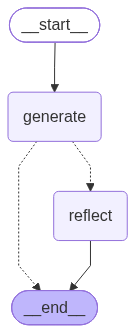
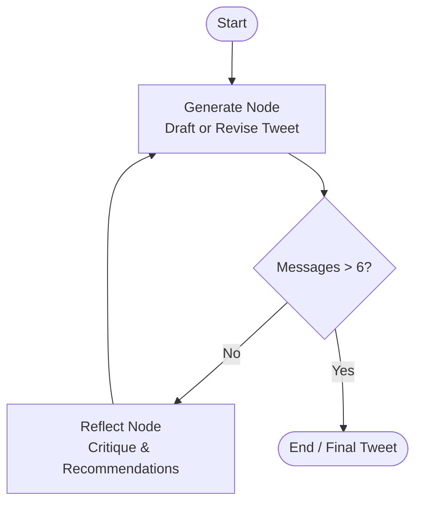

# Reflection Agent 🪞🤖

An iterative AI reflection agent built with **LangGraph**, **LangChain**, and **Google Gemini** (`gemini-3.7-flash`). This project implements the **Reflection Pattern**—an agentic architecture where a generator LLM and a critic LLM collaborate in a cyclic feedback loop to continuously evaluate, critique, and refine content until it reaches optimal quality.



---

## 📑 Table of Contents

- [Overview](#-overview)
- [How It Works](#-how-it-works)
- [Architecture & Workflow](#-architecture--workflow)
- [Repository Structure](#-repository-structure)
- [Prerequisites](#-prerequisites)
- [Installation & Setup](#-installation--setup)
- [Usage](#-usage)
  - [Run the Reflection Agent](#1-run-the-reflection-agent)
  - [Run via Script / Module](#2-run-via-script--module)
  - [Generate or Update Workflow Diagram](#3-generate-or-update-workflow-diagram)
  - [Test Individual Chains](#4-test-individual-chains)
- [Configuration & Customization](#-configuration--customization)
- [Tech Stack](#-tech-stack)

---

## 🌟 Overview

Single-turn LLM generation often produces generic or suboptimal results because the model cannot evaluate its own output before finalizing. 

The **Reflection Pattern** solves this problem by separating generation from evaluation:
1. **Generator**: Acts as a tech content creator crafting the best possible post (or revising based on feedback).
2. **Reflector (Critic)**: Evaluates the draft against specific dimensions such as virality, hook strength, clarity, length, and style.
3. **Iterative Refinement**: The feedback is injected back into the conversation state for the generator to produce an improved iteration.

In this implementation, the agent refines tech Twitter/X posts to maximize engagement, clarity, and viral impact.

---

## 🔄 How It Works



1. **User Request**: The user submits a draft tweet or a topic to write about.
2. **Generation (`generate`)**: The generator chain generates an initial draft.
3. **Condition Check (`should_continue`)**: The state machine checks whether the loop threshold has been reached (`len(messages) > 6`). If reached, execution stops.
4. **Critique (`reflect`)**: If within the threshold, the reflection chain analyzes the draft and returns actionable recommendations.
5. **Revision (`generate`)**: The generator consumes the critique and outputs a revised, higher-quality version.

---

## 📂 Repository Structure

```plaintext
reflection_agent/
├── src/
│   └── reflection_agent/
│       ├── __init__.py       # Initializes package and loads environment variables (.env)
│       ├── chains.py         # Prompt templates and Gemini LCEL chains (generation & reflection)
│       ├── graph.py          # LangGraph state machine, nodes, conditional edges, and compiled graph
│       └── main.py           # Entry point executing the graph on an example tweet
├── flow.png                  # Visual graph representation generated via Mermaid PNG export
├── pyproject.toml            # Project configuration, dependencies, and CLI script entrypoint
├── requirements.txt          # Direct dependencies list
├── uv.lock                   # Lockfile for reproducible environments using uv
├── .python-version           # Specifies required Python version (3.11)
├── .gitignore                # Git ignore rules
└── README.md                 # Project documentation
```

---

## 📋 Prerequisites

- **Python**: Version `3.11` or higher.
- **Google Gemini API Key**: An active Gemini API key from [Google AI Studio](https://aistudio.google.com/).

---

## 🚀 Installation & Setup

### 1. Clone the Repository

```bash
git clone https://github.com/venkataviswas/reflection_agent.git
cd reflection_agent
```

### 2. Set Up Virtual Environment

You can use either **`uv`** (recommended) or standard **`pip`**:

#### Option A: Using `uv` (Fastest)

```bash
# Create and activate virtual environment
uv venv
# On Windows:
.venv\Scripts\activate
# On Linux / macOS:
source .venv/bin/activate

# Install dependencies and project in editable mode
uv sync
```

#### Option B: Using Standard `pip`

```bash
# Create virtual environment
python -m venv .venv

# Activate virtual environment
# On Windows:
.venv\Scripts\activate
# On Linux / macOS:
source .venv/bin/activate

# Install dependencies
pip install -r requirements.txt
pip install -e .
```

### 3. Configure Environment Variables

Create a `.env` file in the root directory:

```bash
# Windows (PowerShell)
New-Item .env -ItemType File

# Linux / macOS
touch .env
```

Add your Google Gemini API key:

```env
GOOGLE_API_KEY=your_gemini_api_key_here
```

*(The package automatically loads `.env` on startup via `python-dotenv` in `reflection_agent/__init__.py`)*.

---

## 💻 Usage

### 1. Run the Reflection Agent

If installed as a package, you can run the registered CLI command directly:

```bash
reflection-agent
```

Or using `uv`:

```bash
uv run reflection-agent
```

### 2. Run via Script / Module

You can also run the main module directly with Python:

```bash
python -m reflection_agent.main
```

### 3. Generate or Update Workflow Diagram

To re-export the state graph diagram to `flow.png`:

```bash
python -m reflection_agent.graph
```

### 4. Test Individual Chains

To test the generation prompt chain standalone:

```bash
python -m reflection_agent.chains
```

---

## ⚙️ Configuration & Customization

### Modifying the LLM Model
By default, the chains use `gemini-3.7-flash`. To switch models (e.g., to `gemini-1.5-pro` or `gemini-2.5-flash`), update `src/reflection_agent/chains.py`:

```python
model = ChatGoogleGenerativeAI(model="gemini-2.5-flash")
```

### Changing the Reflection Depth
The loop stopping condition is defined in `src/reflection_agent/graph.py`:

```python
def should_continue(state: MessageState):
    if len(state["messages"]) > 6:
        return END
    return REFLECT
```

- Each iteration adds 2 messages (1 generated tweet + 1 critique).
- Increase or decrease the threshold (`> 6`) to run more or fewer reflection rounds.

### Customizing Prompts
You can adjust the system personas in `src/reflection_agent/chains.py`:
- **`generation_prompt`**: Alter the persona (e.g., technical educator, casual copywriter, product marketer).
- **`reflection_prompt`**: Alter critique criteria (e.g., SEO score, code accuracy, tone, engagement).

---

## 🛠️ Tech Stack

- **[LangGraph](https://github.com/langchain-ai/langgraph)**: Cyclic state graph orchestration.
- **[LangChain Core](https://github.com/langchain-ai/langchain)**: Prompt templates, message representations, and LCEL chaining.
- **[LangChain Google GenAI](https://github.com/langchain-ai/langchain-google)**: Gemini integration.
- **[uv](https://github.com/astral-sh/uv)**: Blazing fast Python packaging and dependency management.
- **[python-dotenv](https://github.com/theskumar/python-dotenv)**: Seamless environment variable configuration.
